# VenaLab

**A 3D trainer for drawing blood from the arm and hand.** Practise a venipuncture or a fingerstick on a layered, anatomically modelled arm: feel for the vein, cleanse the site, angle and advance the needle yourself, and get a debrief that explains exactly what the needle met. Explore the anatomy layer by layer, map veins in a photo, and look up the order of draw.

**Live:** https://venalab.vercel.app · **30-second demo:** https://venalab.vercel.app/atlas?demo

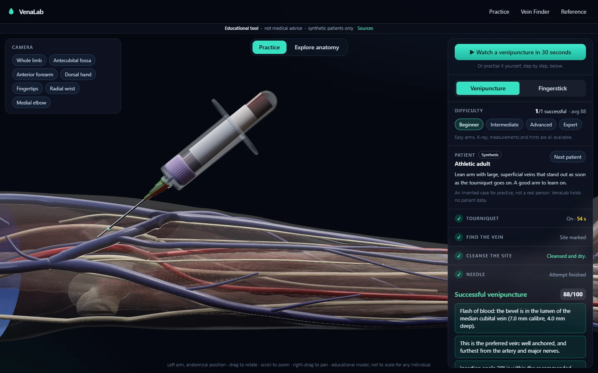

> **Educational tool, not medical advice.** VenaLab is not a medical device, has not been clinically validated and has not been reviewed by a clinician. It must not guide the care of a real patient, and it does not replace supervised practice, your institution's policy, palpation or clinical judgement. Every patient in it is synthetic.

## Contents

- [What it does](#what-it-does)
- [Practice: venipuncture](#practice-venipuncture)
- [Practice: fingerstick](#practice-fingerstick)
- [Explore anatomy](#explore-anatomy)
- [Photo vein finder](#photo-vein-finder)
- [Bedside reference](#bedside-reference)
- [On a phone](#on-a-phone)
- [Sources](#sources)
- [Data and privacy](#data-and-privacy)
- [How it works](#how-it-works)
- [Running it](#running-it)
- [Project layout](#project-layout)
- [Limitations](#limitations)
- [Contributing](#contributing)
- [Credits and licence](#credits-and-licence)

## What it does

| Page | What you do there |
| --- | --- |
| **Practice** — `/atlas` | Run a venipuncture or a fingerstick from start to finish on one of nine synthetic patients, at four levels of difficulty, and get a scored debrief. Or watch a narrated demonstration. |
| **Explore anatomy** — `/atlas?mode=explore` | Peel the arm from skin to bone, pick out any of more than 50 structures for its anatomy and bedside relevance, and take a guided tour. |
| **Photo vein finder** — `/vein-finder` | Give it a photo of an inner elbow, forearm or back of a hand; it maps the visible veins and ranks places to puncture. The photo never leaves the device. |
| **Bedside reference** — `/reference` | The order of draw (with a trainer), the procedure step by step, where to draw and where never to, and how to handle complications, each with its source. |

## Practice: venipuncture

The practice page opens on the whole arm. The panel on the right holds one step at a time; finished steps fold up to a tick and a one-line summary, and you can go back to an earlier step while the needle is out of the skin.

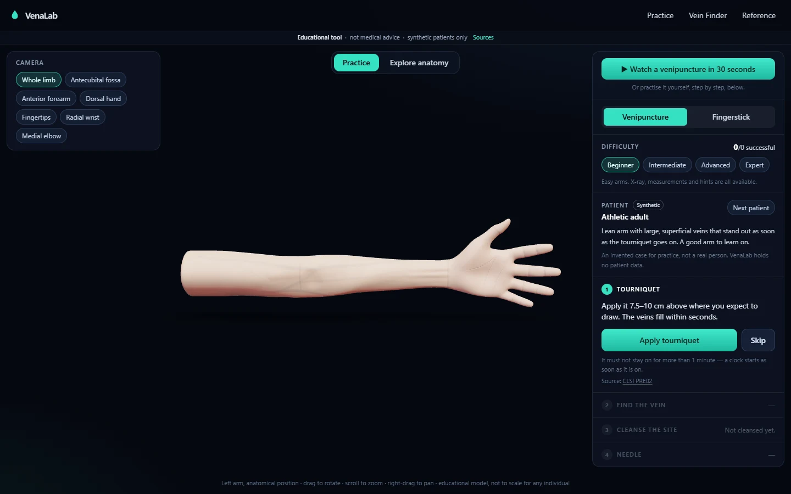

### 1 · Tourniquet

Apply it and a clock starts beside the step. The veins fill and rise under the skin over a few seconds. If more than a minute passes before the puncture, the debrief marks it down: haemoconcentration alters results.

### 2 · Find the vein

A gloved fingertip follows the pointer over the arm and presses into the skin. What it feels is written beside it and in the panel:

- **Vein:** soft and bouncy, springs back when pressed. A deep vein is felt only with firm, slow pressure.
- **Artery:** pulsatile; the fingertip throbs with the pulse.
- **Tendon:** a hard cord with no bounce.

At Beginner level the panel also gives the vein's width and depth. Click the vein to mark the puncture site.

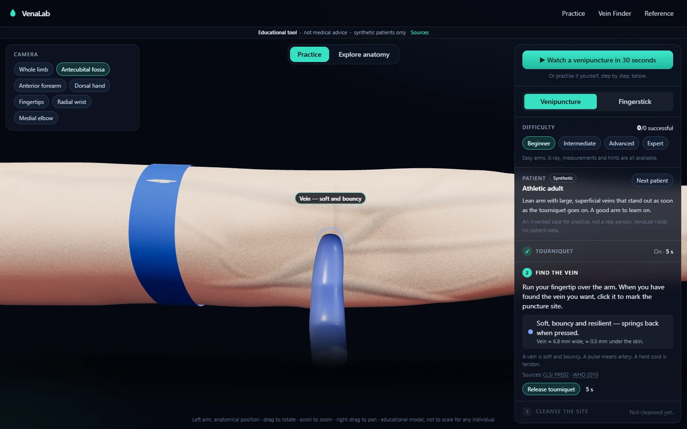

### 3 · Cleanse

You are holding a 70% isopropyl alcohol wipe. Rub it to and fro over the ringed site until the bar is full. The wet sheen then dries away over a few seconds; puncturing through wet alcohol is marked down, because it stings and can haemolyse the sample. (At the bedside it takes about 30 seconds to dry.)

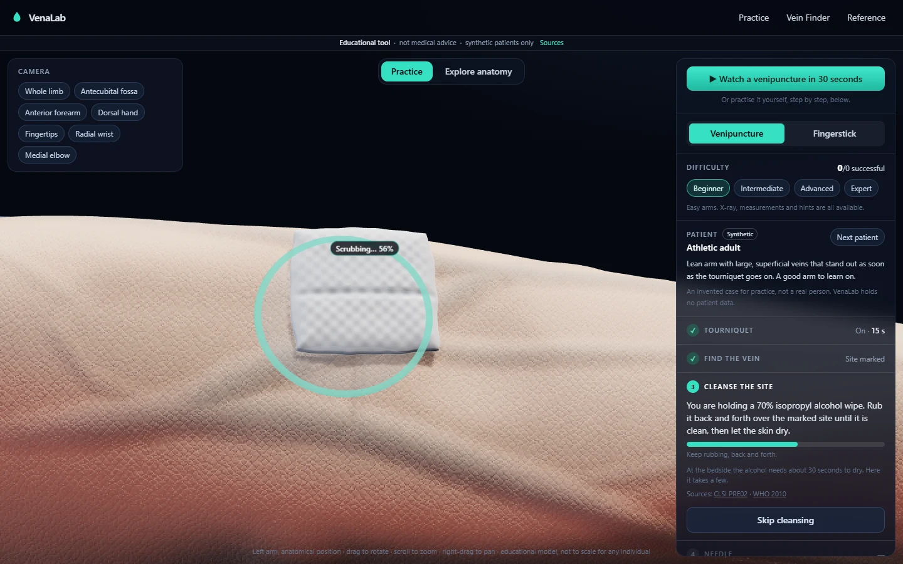

### 4 · Needle

Choose the gauge (21G, 22G or a 23G winged set) and whether to anchor the vein, then take hold of the needle:

| | Mouse | Touch | Panel / keyboard |
| --- | --- | --- | --- |
| Tilt and aim | Drag the holder (teal ring) | Drag the holder | *Angle to skin* and *Direction* sliders |
| Push in, draw back | Drag the end of the tube (amber ring), or scroll over the needle | Drag the end of the tube | *Needle in the skin* slider; *Advance* / *Draw back* buttons (hold to repeat); ↑ ↓ keys |

A readout beside the hub shows the angle and how far the needle is in. Once the tip is in the skin it can only slide along its own axis: it cannot be levered about.

When the bevel enters a vessel, blood flashes in the hub, the tube slides home and fills. It fills steadily from a vein, and bright and in pulses from an artery. Go through the back wall and the flash stops and a haematoma spreads. *X-ray* shows the anatomy at the levels that allow it.

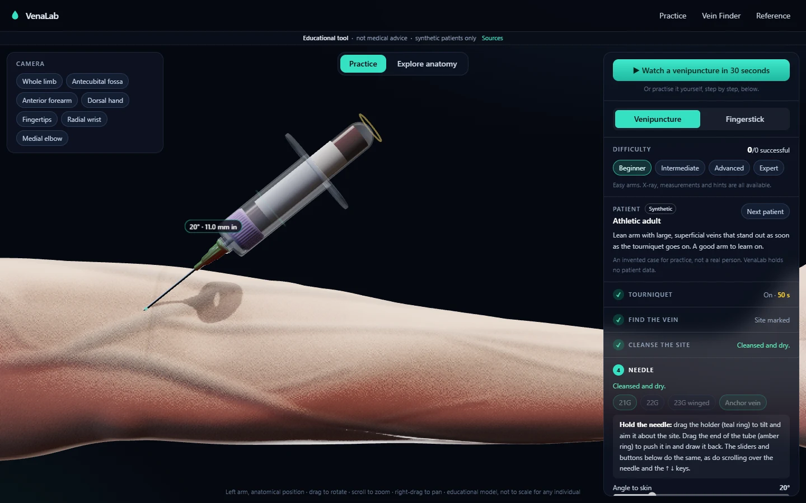

### 5 · Debrief

*Finish attempt* reveals the anatomy around the needle and scores the attempt out of 100. Each note says what happened and why it matters. The running tally of attempts, successes and average score sits at the top of the panel.

#### How an attempt is marked

What the needle met decides the outcome. The worst thing it touched at any point counts, even if it was drawn back afterwards.

| Outcome | Score | What the debrief says |
| --- | --- | --- |
| Artery entered | 0 | Which artery; release, withdraw, press for at least 5 minutes, check the distal pulse, report |
| Nerve struck | 0 | Which nerve; stop at once, do not redirect, document |
| Through the vein | 25 | Brief flash then nothing; a haematoma forms from the back wall |
| Missed | 10 | The nearest vein, how far away, and in which direction (deeper or shallower, toward the thumb or little finger) |
| In the vein | from 100, less deductions | See below |

Deductions when blood is obtained:

| | Points |
| --- | --- |
| Second-choice vein (cephalic) | −5 |
| Hand or forearm alternative | −8 |
| Last-resort vein (basilic) | −18 |
| A vein too small to use | −45 |
| Reached a deep brachial vein | −40 |
| Angle over 30° | −20 |
| Angle outside 15–30° at the elbow, or 10–15° on the hand | −8 |
| Pointing toward the hand instead of toward the heart | −15 |
| Crossing the vein instead of following it | −12 |
| Tip against the vein wall | −6 |
| No tourniquet | −10 |
| 21G in a hand vein | −8 |
| Passed within 4 mm of an artery or nerve ("close call") | −12 |
| Palmar wrist or hand | −40 |

Deductions for the procedure around the needle:

| | Points |
| --- | --- |
| Site not cleansed | −15 |
| Alcohol still wet | −6 |
| Tourniquet on for more than a minute | −8 |
| Vein not anchored (advanced levels, or a vein that rolls) | −6 |
| 21G in fragile veins | −8 |
| Needle withdrawn with the tourniquet still on | −8 |

A vein that rolls offers a smaller target unless it is anchored, so an unanchored attempt on a frail patient often misses.

### Patients and difficulty

Every patient is an invented description of a kind of arm, not a person. The arm is rebuilt for each one: the soft tissue is thicker or thinner, the veins deeper, smaller, harder to see or quicker to roll, and the surface anatomy fades under more tissue.

| Patient | Build | Veins | Shows through skin | Rolls | Fragile |
| --- | --- | --- | --- | --- | --- |
| Athletic adult | lean | large, superficial | clearly | — | — |
| Average adult | average | average | faintly | — | — |
| Adult with an M-shaped pattern | average | no median cubital: median, median cephalic, median basilic | faintly | — | — |
| Adult with deep skin tone | average | average | barely | — | — |
| Adult of higher body weight | heavier | 3 mm deeper | barely | — | — |
| Dehydrated adult | average | small and flat | poorly | slightly | — |
| Slender older adult | slender | smaller | clearly | yes | yes |
| Adult with obesity | much heavier | 5.5 mm deeper | not at all | slightly | — |
| Frail elderly patient | thin | small, mobile | faintly | readily | yes |

| Level | Patients drawn from | Help given |
| --- | --- | --- |
| Beginner | athletic, average | X-ray, measurements while palpating, hints |
| Intermediate | adds the M pattern and deep skin tone | X-ray and hints; no measurements |
| Advanced | higher weight, dehydrated, older, deep skin tone, M pattern | No X-ray until you finish, no hints; every step counts |
| Expert | obesity, frail, dehydrated, older, higher weight | As Advanced: marked as at the bedside |

### The 30-second demonstration

*Watch a venipuncture in 30 seconds*, the first button on the practice page, plays a textbook puncture of the first-choice vein on the current patient in nine narrated steps: identify, tourniquet, palpate, the anatomy beneath, cleanse, anchor and aim, advance, draw, withdraw. `/atlas?demo` starts it as soon as the arm is built, which makes it the quickest way to show VenaLab to someone.

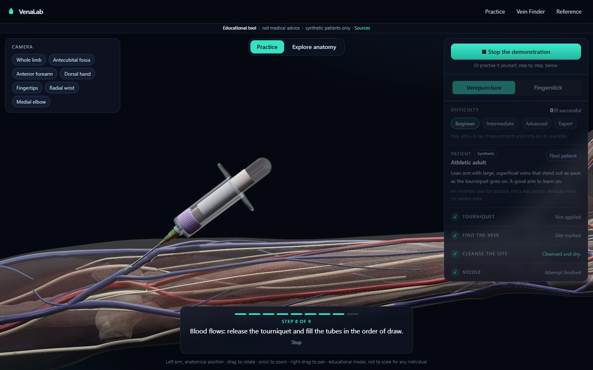

## Practice: fingerstick

The same arm, for a capillary puncture, in five steps:

1. **Prepare the hand:** warm it, or skip and see what a cold hand does to the flow.
2. **Choose the site:** the finger under the pointer is named as you move ("Middle finger — pad, just off-centre"), and at the easier levels the recommended places are marked in green.
3. **Cleanse** with the wipe.
4. **Lancet:**
   - Set the depth: 1.0, 1.5, 2.2 or 2.8 mm.
   - Turn the blade across or along the fingerprint ridges.
   - Fire it. The safety lancet presses in and is lifted away.
5. **Collect:**
   - Wipe away the first drop.
   - Choose gentle, intermittent pressure or squeezing hard.
   - Choose which tube to fill first.
   - A microcollection tube then takes the drop.

<p>
  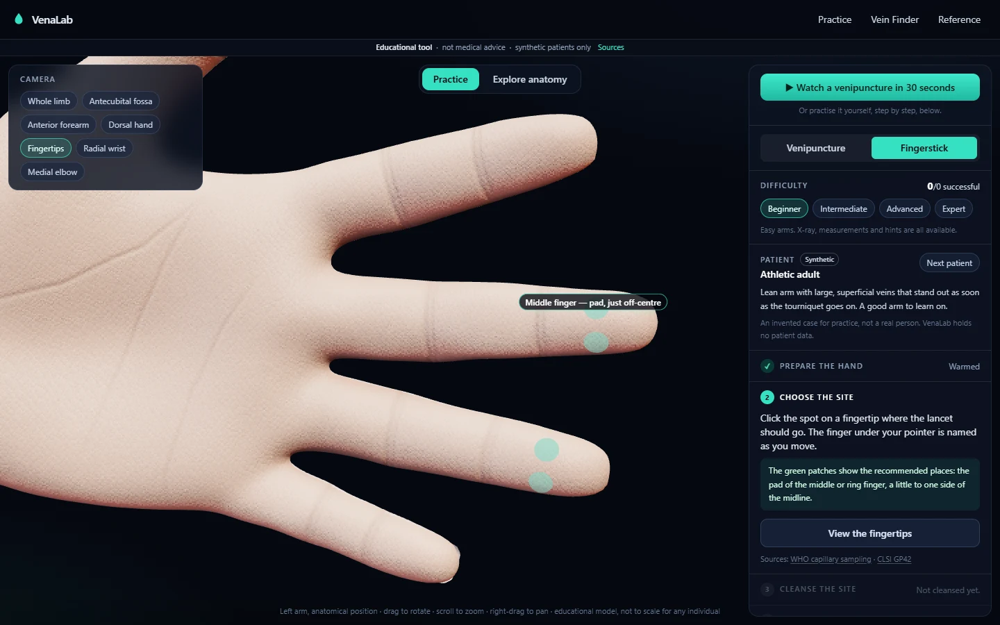
  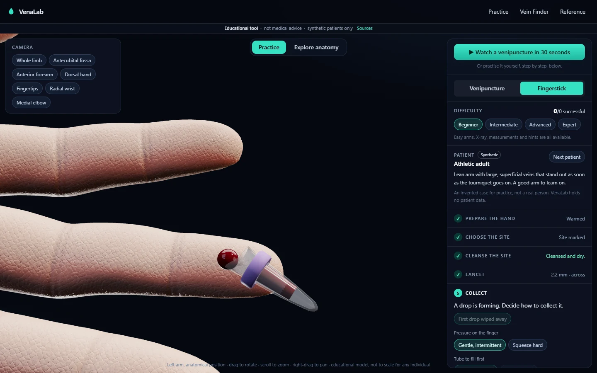
</p>

The debrief explains each choice:

| | Points |
| --- | --- |
| Middle or ring finger | correct |
| Index finger | −15 |
| Thumb or little finger | −30 |
| Back of the finger, over the nail bed | −45, no usable sample |
| Side of the finger, or the very tip | −30 |
| Near the joint crease | −12 |
| Dead centre of the pad | −8 |
| Deeper than 2.4 mm | −30 |
| Shallower than 1.5 mm | −10 |
| 1.5 mm (a child's depth) | −4 |
| Blade along the ridges | −10 |
| Not cleansed / still wet | −15 / −8 |
| Hand not warmed | −6 |
| First drop collected | −15 |
| Squeezed hard ("milking") | −15 |
| Serum tube before EDTA | −10 |

A sample counts as collected at 60 or more.

## Explore anatomy

Switch to **Explore anatomy** at the top of the page. The arm assembles from the bone outward.

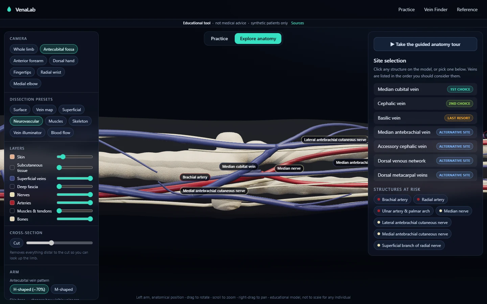

- **Eight layers**, each with its own opacity: skin, subcutaneous tissue, superficial veins, deep fascia, nerves, arteries, muscles and tendons, bones.
- **Dissection presets** that peel smoothly from one to the next:

  | Preset | Shows |
  | --- | --- |
  | Surface | What you see at the bedside |
  | Vein map | Veins through translucent skin |
  | Superficial | Veins and cutaneous nerves on the deep fascia |
  | Neurovascular | Veins, arteries and nerves over the skeleton |
  | Muscles | Everything beneath the fascia |
  | Skeleton | Veins against the bony landmarks |

- **Vein illuminator:** a simulated near-infrared viewer, in which veins show dark against bright skin.
- **Blood flow:** cells stream along the veins toward the heart, and pulse along the arteries away from it.
- **Cross-section:** a sliding cut that removes everything beyond it, so you can look up the limb.
- **The arm:**
  - Both common antecubital patterns: H-shaped (about 70% of people) and M-shaped.
  - Four skin tones, which change how visible the veins are.
  - Tourniquet and labels.
- **Seven camera views:** whole limb, antecubital fossa, anterior forearm, dorsal hand, fingertips, radial wrist, medial elbow.
- **A guided tour** in eight narrated steps, from the surface to the bone.

Click any structure, or pick one from the list, for its anatomy, what it means at the bedside, its typical measurements and, for veins, its rating as a puncture site (first choice, second choice, last resort, alternative). The structures at risk are listed separately.

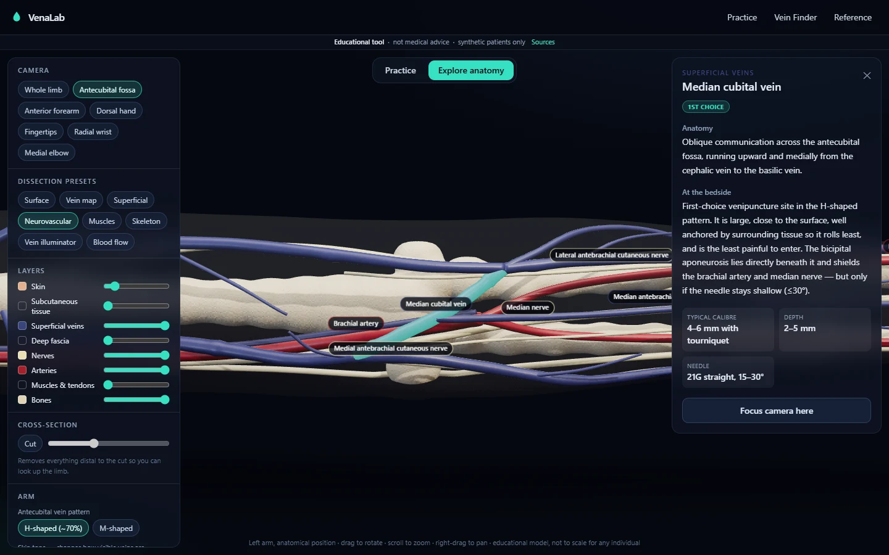

<p>
  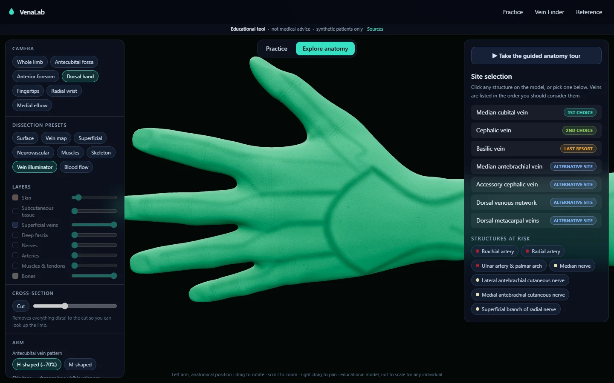
  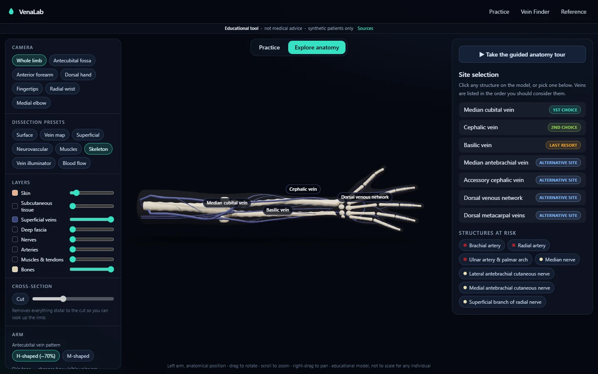
</p>

**What is modelled** (more than 50 structures across both vein patterns):

- **Veins:**
  - At the elbow: the cephalic, basilic and median cubital veins.
  - In the M pattern: the median, median cephalic and median basilic veins.
  - In the forearm: the median antebrachial and accessory cephalic veins, and superficial tributaries.
  - In the hand: the dorsal venous network, and the dorsal metacarpal and dorsal digital veins.
  - Deep: the brachial veins and the perforating vein.
  - Valves are drawn on the main trunks.
- **Arteries:** brachial, radial, ulnar and the palmar arch, palmar digital.
- **Nerves:**
  - Median, ulnar and radial.
  - The superficial branch of the radial nerve.
  - The lateral and medial antebrachial cutaneous nerves.
  - Palmar digital.
- **Muscles and tendons:**
  - Biceps and its tendon, the bicipital aponeurosis, brachialis, brachioradialis, triceps, anconeus.
  - Pronator teres, pronator quadratus, supinator.
  - The flexors and extensors of the wrist and fingers, palmaris longus, the thenar and hypothenar muscles, dorsal interossei.
  - The tendons of the hand and of the anatomical snuffbox, and the retinacula.
- **Bones:** humerus, radius, ulna, carpals, metacarpals, phalanges, interosseous membrane.

## Photo vein finder

Upload a photo, take one with the phone's camera, or try one of three practice images (computer-generated drawings, not photos of anyone). Say what the photo shows: inner elbow, forearm or back of hand.

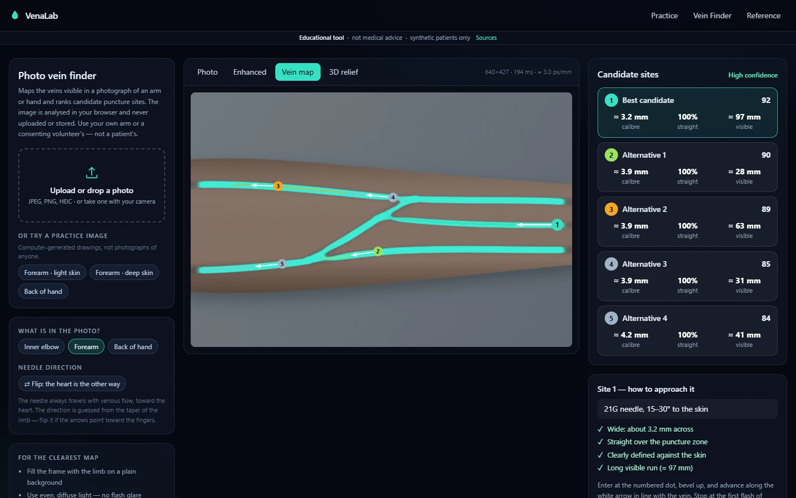

**How the analysis works.** It runs in the browser, typically in under half a second:

1. Segment the limb by skin chroma (or by brightness, for a near-infrared image).
2. Build a channel in which veins are dark: slightly darker than skin and distinctly less red.
3. Flatten the lighting and normalise local contrast.
4. Apply a multi-scale Hessian ridge filter (Frangi vesselness).
5. Threshold with hysteresis, thin and trace the result into branches.
6. Score each branch on calibre, straightness, contrast, length, alignment with the limb and distance from its edge.

**What it returns:**

- Up to five ranked sites, each with an entry point, needle direction (toward the heart; flip it if it guessed wrong), estimated calibre, reasons, cautions and suggested equipment.
- Checks of image quality: vein signal, sharpness, evenness of lighting, how much of the frame the limb fills.
- Four views: the photo, the enhanced channel, the vein map, and a 3D relief of the photo with the needle posed on the chosen site.

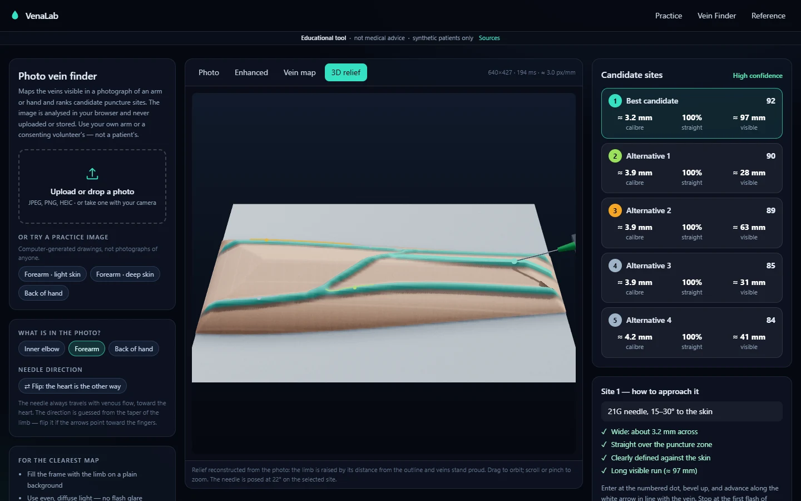

A photograph cannot show arteries, nerves, depth or valves, and cannot tell a vein from a tendon, a shadow or a tattoo. Sizes are scaled from a typical limb width. The page says all this beside the results.

## Bedside reference

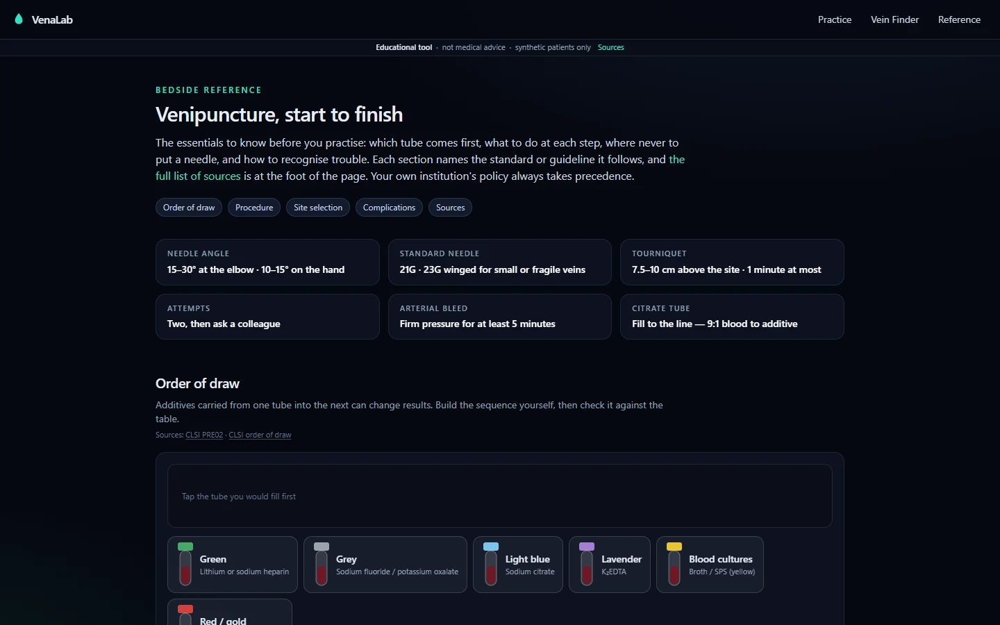

- **Order of draw:**
  - The CLSI sequence as a table: tube, additive, typical tests and inversions.
  - A trainer in which you build the sequence yourself. A wrong pick explains why the right tube comes first.
  - A note on the discard tube needed before citrate with a winged set.
- **Procedure:** twelve steps, from identifying the patient to labelling at the bedside.
- **Site selection:** where to look, in order, and where never to draw.
- **Complications:** how to recognise each of ten and how to respond.
- **Sources** for every section, listed in full at the foot of the page.

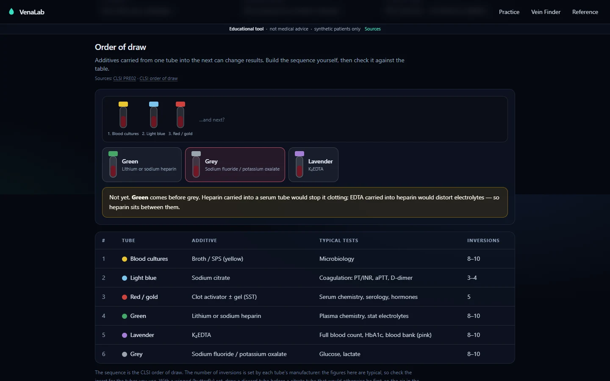

## On a phone

Every feature works by touch.

<p>
  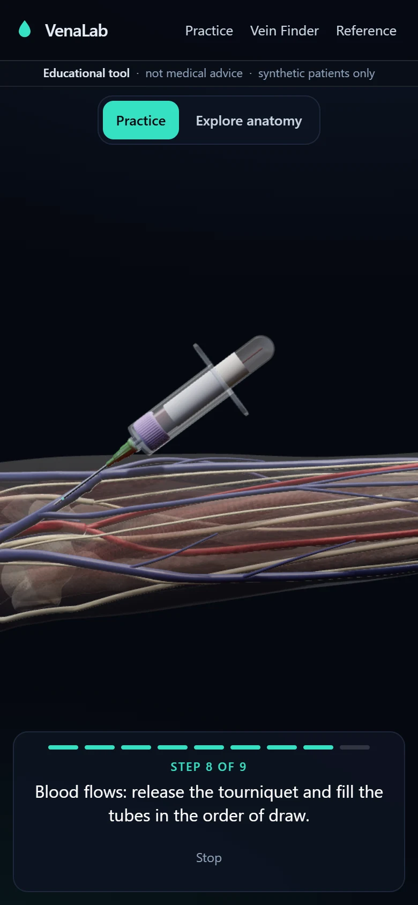
  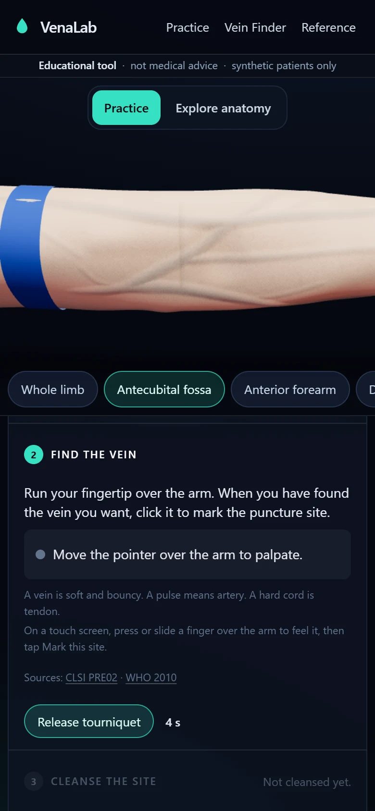
  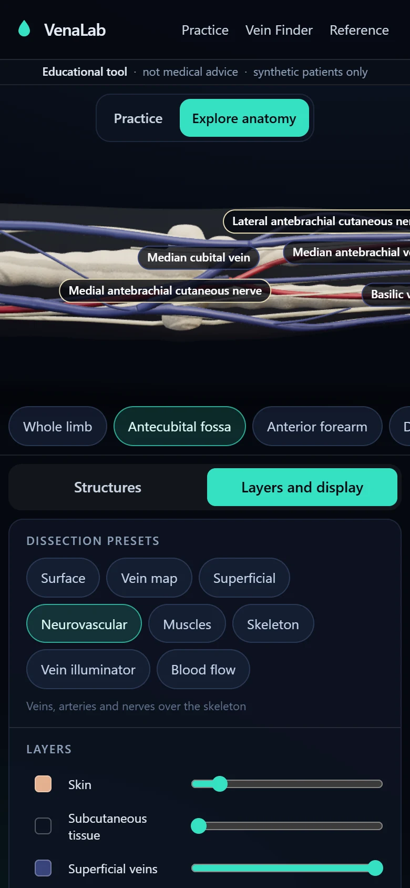
  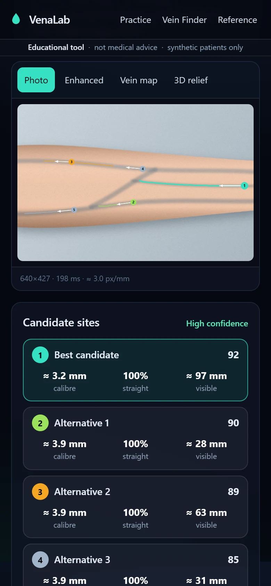
</p>

- **Layout:** held upright, the model has the top of the screen and the panel scrolls beneath it. Turned on its side, they sit next to each other. During the demonstration the model takes the whole screen.
- **Camera views** are a row of chips along the foot of the model.
- **Practice by touch:**
  - A finger on the arm palpates; then tap *Mark this site*.
  - A finger scrubs with the wipe.
  - A finger names a fingertip, and a tap marks it.
  - The needle can be dragged, and also has sliders and hold-to-repeat *Advance* / *Draw back* buttons.
- **Explore** has a second tab, *Layers and display*, for the presets and layers.
- **Vein finder and reference:** the vein finder takes a photo from the camera, and the order of draw becomes cards.
- **Controls** are sized for a fingertip on touch screens, and the page keeps clear of a notch.
- **Older or weaker devices:** the model needs WebGL 2. Browsers that cannot unpack the model file themselves (iOS before 16.4) use a small fallback. If the model cannot be built at all, the page says why and offers to reload.

## Sources

The teaching content is written from published standards and guidelines. The app cites them where it uses them: beside each step in Practice, and on the reference page.

| Used for | Source |
| --- | --- |
| Order of draw, tourniquet time, choice of vein, needle angle | CLSI PRE02, *Collection of Diagnostic Venous Blood Specimens*, 8th ed., 2025 (replaces GP41) |
| Fingerstick technique | CLSI GP42, *Collection of Capillary Blood Specimens*, 7th ed., 2020 |
| Steps of a venipuncture, skin antisepsis, lancet depth, capillary collection | *WHO guidelines on drawing blood: best practices in phlebotomy*, 2010, and its job aid on capillary sampling |
| Single use of needles and collection devices | CDC, *Preventing Unsafe Injection Practices* |
| Hand hygiene | CDC, *Clinical Safety: Hand Hygiene for Healthcare Workers* |
| No recapping, immediate sharps disposal | OSHA Bloodborne Pathogens Standard, 29 CFR 1910.1030 |

The CLSI standards are sold rather than free to read; figures attributed to them are those taught from them, and should be checked against the current edition. Where sources differ, the stricter figure is used. VenaLab is not reviewed or endorsed by any of these organisations.

## Data and privacy

- **Every patient is synthetic.** The nine patients are invented descriptions of kinds of arm, written for teaching. None is, or is derived from, a real person or record, and the app says so beside each one.
- **No patient data is used anywhere.** The arm is a generic model built from a CC0 body mesh and anatomical parameters. The vein finder's practice images are drawn by code.
- **The app collects nothing.** There are no accounts, no analytics, no cookies and no uploads. A photo given to the vein finder is analysed in the browser tab and never leaves the device. Use your own arm or a consenting volunteer's, not a patient's.
- **It is an educational tool, not medical advice.** That is stated on every page.

## How it works

Everything runs in the browser; there is no server-side code beyond serving the static pages.

```
 Blender + MakeHuman (MPFB)                       Browser
 ──────────────────────────                       ────────────────────────────────────────────
 tools/limb/bake_limb.py                          Web Worker (build.worker.ts)
   pose a CC0 body, cut the left arm,               skin field ─► surface nets ─► skin, fat, fascia
   bake a signed distance field          ──►        structures.ts ─► vessels, nerves, muscles, bones
 public/models/limb.bin.gz (2 mm grid)              per-patient build (girth, vein depth, calibre)
 public/models/kit.glb (instruments)                        │ packed buffers
                                                            ▼
                                                  React Three Fiber scene (Scene.tsx)
                                                    shaders (materials.ts), instruments (Tools, Fingerstick)
                                                    Zustand store (store.ts): steps, scoring, camera
                                                    sim.ts / capillary.ts: needle and lancet physics of the debrief
```

**The skin.** The surface of the arm and hand comes from a MakeHuman body (CC0), posed in the anatomical position in Blender and baked by `tools/limb/bake_limb.py` into a signed distance field:

- **Storage:** a 2 mm grid, 351 × 91 × 66 samples of 16 bits, gzip-compressed to 1.3 MB. It is read with trilinear interpolation.
- **Surface anatomy** is raised on the field, each feature placed from the skin itself: the wrist flexor tendons, the biceps tendon and the hollows either side of it, the olecranon, medial epicondyle, ulnar head and radial styloid, and the knuckles with their extensor tendons. It fades under thicker soft tissue.
- **Meshing:** surface nets turn the field into a mesh on a 1.1 mm grid. The subcutaneous tissue and deep fascia are deeper iso-surfaces of the same field.
- **Build:** a heavier or leaner patient is the same arm with its cross-sections scaled about their centres; the hand keeps its size.

**Everything beneath the skin** is generated from anatomical parameters when the page opens:

- **Vessels and nerves** are placed by station along the limb, angle around it and depth beneath the skin. They are re-projected onto their tissue plane, so they stay at a realistic depth as the surface curves. The layout is drawn on a reference limb of measured cross-sections and carried onto the modelled arm section by section; the structures of the fingers follow the joints of the modelled hand.
- **Bones** are smooth unions of implicit primitives, so shafts flare into their ends and processes blend into the bone.
- **Surface detail is procedural shading:**
  - pores, creases, palm lines and knuckle wrinkles on the skin;
  - veins showing through as a tint that strengthens under a tourniquet;
  - fibre grain on muscle, lobules on fat, collagen on fascia.

  No textures are used.
- **Instruments:** the needle, hub, holder, evacuated tube, alcohol wipe, gauze, safety lancet, microcollection tube and gloved fingertip are modelled in Blender and shipped as one GLB file.

**Building it** takes about 1.5 seconds in a Web Worker. The skin mesh is built once per build of arm; the structures are rebuilt for each patient or vein pattern.

**The simulation** steps the needle along its path in 0.2 mm increments and tests every point against the centre-lines and radii of every vein, artery and nerve. A vein's radius widens under a tourniquet and narrows when it rolls away from an unanchored needle. Palpation tests the fingertip's point against the same centre-lines.

**Coordinates** are in centimetres:

- `x` runs from proximal to distal, with the elbow crease at 0;
- `y` runs from ulnar to radial;
- `z` runs from posterior to anterior.

The model is a left arm in the anatomical position. It is a generic adult limb: real anatomy varies, and some calibres are slightly enlarged for legibility.

**Stack:**

- Next.js 16 (App Router), React 19, TypeScript 5.9
- three.js 0.187 with React Three Fiber 9 and drei 10
- Zustand 5, Tailwind CSS 4
- fflate, only as a fallback for older browsers

## Running it

Requires Node.js 20 or later (22 or later for the screenshot script).

```bash
npm install
npm run dev
```

Open http://localhost:3000. It opens on the practice page.

| Script | Does |
| --- | --- |
| `npm run dev` | Development server with hot reload |
| `npm run build` | Production build |
| `npm run start` | Serve the production build |
| `npm run typecheck` | Type-check without building |
| `npm run screenshots` | Retake every image in `docs/screenshots` (see below) |

**Deploying.** The site is static and needs no environment variables. The live site deploys to Vercel automatically from `main`.

**Retaking the screenshots.** `tools/screenshots/capture.mjs` drives a headless Edge or Chrome over the DevTools protocol, so there is nothing to install:

- It palpates, marks, scrubs, aims the needle and picks a fingertip with real pointer input.
- It searches the arm for the median cubital vein, and then for a heading that enters it.
- It takes the live site by default. Point `BASE` at another server, using a production build, because the development server draws a badge in the corner.
- Name groups to retake only those: `venipuncture`, `demo`, `fingerstick`, `explore`, `veinFinder`, `reference`, `phone`.

```bash
npm run build && npm run start
BASE=http://localhost:3000 npm run screenshots -- explore phone
```

Set `BROWSER` to the browser's executable if it is not found.

**Rebuilding the arm.** `tools/limb/bake_limb.py` runs inside Blender (5.x) with the MakeHuman add-on, MPFB, and a body named `Human` with its rig. It writes `public/models/limb.bin.gz` and `src/lib/anatomy/limb.ts`, the joints of the modelled hand and the cross-sections of the limb, in about 6 seconds:

```python
p = r"<repository>/tools/limb/bake_limb.py"
exec(compile(open(p).read(), p, "exec"), {"__file__": p})
```

## Project layout

```
src/
  app/
    atlas/               practice and explore (the home page redirects here)
    vein-finder/         photo vein finder
    reference/           bedside reference
    layout.tsx           header and the educational notice on every page
  components/
    atlas/               Scene (3D), store (state, steps, scoring, camera framing), materials (shaders),
                         Tools (fingertip, wipe), Fingerstick, PracticePanel, Panels, demo (demonstration
                         and tour), useAnatomy (talks to the build worker)
    veinfinder/          upload, analysis views, 3D relief
    reference/           order-of-draw trainer, source citations
  lib/
    anatomy/             skin (distance field, surface anatomy), limb (generated), structures (every
                         structure and its notes), geometry (meshing), patients, sim (needle), capillary
                         (fingerstick), build.worker
    veinfinder/          image-analysis pipeline, practice images
    reference/           tubes, sources
public/models/           limb.bin.gz (skin field), kit.glb (instruments)
tools/
  limb/                  Blender script that bakes the arm
  screenshots/           script that takes the README's screenshots
docs/screenshots/        the images in this README
```

## Limitations

- **Not clinically reviewed.** The anatomy and teaching follow published descriptions and the sources above, but no clinician has reviewed them.
- **One arm.** Every patient is the same generic adult left arm, with its soft tissue scaled and its veins changed. There are no children, no right arm and no individual variation beyond the two antecubital patterns.
- **The vein finder is unvalidated.** It has been tried on its practice images, not on a body of real photographs, and it is not a medical device.
- **Tested in emulation.** The phone layout and touch controls have been tested in a phone-sized browser with simulated touch, not on physical phones or in iOS Safari. Pinch-zoom while palpating or scrubbing is untested.
- **WebGL 2 required.** Without it the 3D pages show a message instead of the model.

## Contributing

Every change goes to `main` through its own pull request and is squash-merged; keep each one to a single change, and say in it how it was checked. Clinical content needs a source: add it to `src/lib/reference/sources.ts` and cite it with `<Cite>` where it is used. Never add real patient data.

## Credits and licence

- The arm and hand are derived from a MakeHuman body, released under CC0 and made with the MPFB add-on for Blender.
- Built with three.js, React Three Fiber, drei, Next.js and Zustand.

VenaLab is released under the MIT licence.
